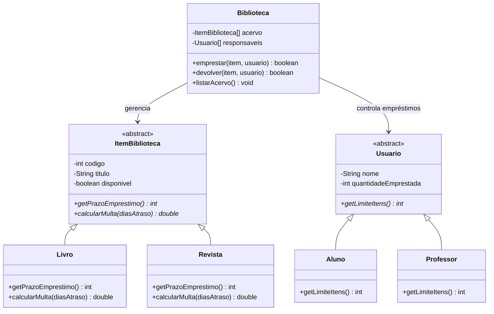
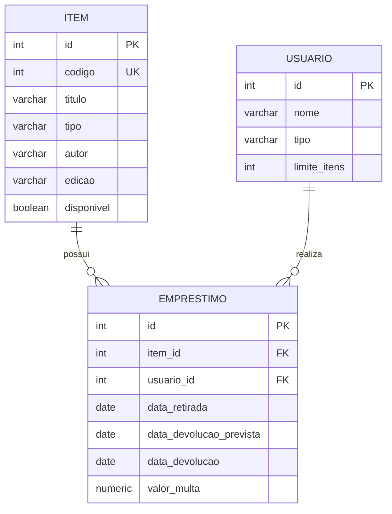

<div align="center">

# 📚 Sistema de Biblioteca

### Java • Programação Orientada a Objetos • PostgreSQL

Sistema de gerenciamento de acervo e empréstimos, desenvolvido como atividade prática da formação **Desenvolvedor Full Stack | +praTi & Codifica**.


</div>

---

## ✨ Sobre o projeto

Uma biblioteca precisa gerenciar diferentes tipos de materiais e usuários, respeitando regras específicas de empréstimo.

Este projeto explora esse cenário em três etapas:

**01 - Programação Orientada a Objetos:** implementação das classes e regras de negócio em Java.

**02 - Modelagem relacional:** criação das tabelas e relacionamentos no PostgreSQL.

**03 - Consultas SQL:** recuperação e análise das informações armazenadas.

O objetivo é aplicar conceitos fundamentais de desenvolvimento de software em um cenário prático, com foco em organização, reutilização de código e integridade dos dados.

---

## 🧩 Funcionalidades

- Cadastro de livros e revistas no acervo.
- Cadastro de alunos e professores.
- Controle de disponibilidade dos itens.
- Empréstimos com limites específicos por categoria de usuário.
- Devoluções com validação do responsável pelo item.
- Cálculo de multas por atraso.
- Listagem do acervo com prazo e disponibilidade.
- Consultas SQL para acompanhamento dos empréstimos e multas.

---

## 🏗️ Estrutura e conceitos de POO

O sistema utiliza **classes abstratas, herança, polimorfismo e encapsulamento**.



A utilização de classes abstratas permite que cada categoria implemente seu próprio comportamento, enquanto a classe `Biblioteca` centraliza as operações de empréstimo e devolução.

---

## 📖 Regras de negócio

### Tipos de materiais

| Material | Prazo de empréstimo | Multa por atraso |
|:---|:---:|---:|
| 📘 Livro | 14 dias | R$ 0,50/dia |
| 📰 Revista | 7 dias | R$ 1,00/dia |

### Categorias de usuários

| Usuário | Limite simultâneo |
|:---|:---:|
| 🎓 Aluno | 3 itens |
| 👨‍🏫 Professor | 5 itens |

As regras são implementadas por meio de métodos sobrescritos nas subclasses, evitando verificações condicionais de tipo nas operações principais.

---

## 🗄️ Banco de dados

A modelagem relacional foi desenvolvida no **PostgreSQL 18**, utilizando três tabelas:

| Tabela | Responsabilidade |
|:---|:---|
| `item` | Armazena os dados de livros e revistas |
| `usuario` | Registra alunos, professores e seus limites |
| `emprestimo` | Relaciona usuários e itens, com datas e multas |

### Relacionamentos



A estrutura utiliza chaves primárias com `GENERATED ALWAYS AS IDENTITY`, chaves estrangeiras e restrições `CHECK` para garantir a consistência dos dados.

---

## 🔎 Consultas SQL

O projeto inclui quatro consultas:

| # | Consulta | Objetivo |
|:---:|:---|:---|
| 01 | Acervo completo | Exibir itens e disponibilidade |
| 02 | Empréstimos em aberto | Identificar itens ainda não devolvidos |
| 03 | Multas por usuário | Calcular os valores acumulados |
| 04 | Itens nunca emprestados | Identificar materiais sem histórico de empréstimo |

São utilizados recursos como `JOIN`, `LEFT JOIN`, `GROUP BY`, `SUM`, `COALESCE` e `IS NULL`.

---

## 🚀 Como executar

### Pré-requisitos

- Java JDK 21
- PostgreSQL 18
- IntelliJ IDEA ou outra IDE Java
- pgAdmin 4 ou outro cliente PostgreSQL

### 1. Executar a aplicação Java

Clone o repositório:

```bash
git clone https://github.com/danieli-dutra/sistema-biblioteca-java-postgresql.git
```

Abra o projeto em uma IDE com o JDK 21 configurado e execute:

`src/biblioteca/Main.java`

O programa demonstrará os cenários de empréstimo, devolução, limite de usuários, multas e disponibilidade do acervo.

### 2. Preparar o banco de dados

Crie um banco de dados vazio no PostgreSQL, por exemplo:

```sql
CREATE DATABASE biblioteca_db;
```

Conecte-se ao banco criado e execute os arquivos da pasta `sql/` nesta ordem:

```text
01_criar_tabelas.sql
        ↓
02_inserir_dados.sql
        ↓
03_consultas.sql
```

Os scripts permitem criar as tabelas, inserir os registros de exemplo e executar as quatro consultas solicitadas.

> **Nota:** os exercícios Java e PostgreSQL são independentes. A aplicação Java utiliza arrays em memória e não realiza conexão direta com o banco de dados.

---

## ✅ Testes realizados

A execução da aplicação Java contempla:

- Empréstimos dentro do limite permitido.
- Recusa de empréstimos acima do limite.
- Bloqueio de devolução por usuário não responsável.
- Liberação do item após devolução válida.
- Cálculo de multas para livros e revistas.
- Atualização da disponibilidade no acervo.

Os scripts SQL também foram executados em um banco de teste vazio, com conferência dos registros e resultados das quatro consultas.

---

## 📂 Organização do projeto

```text
sistema-biblioteca/
├── src/
│   └── biblioteca/
│       ├── ItemBiblioteca.java
│       ├── Livro.java
│       ├── Revista.java
│       ├── Usuario.java
│       ├── Aluno.java
│       ├── Professor.java
│       ├── Biblioteca.java
│       └── Main.java
├── sql/
│   ├── 01_criar_tabelas.sql
│   ├── 02_inserir_dados.sql
│   └── 03_consultas.sql
├── .gitignore
└── README.md
```

---

<div align="center">

### 👩‍💻 Desenvolvido por Danieli Dutra Braga

Atividade prática • Formação Full Stack • +praTi & Codifica

[GitHub](https://github.com/danieli-dutra) · [LinkedIn](https://www.linkedin.com/in/danieli-dutra/)

</div>
